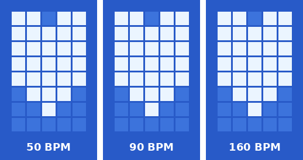
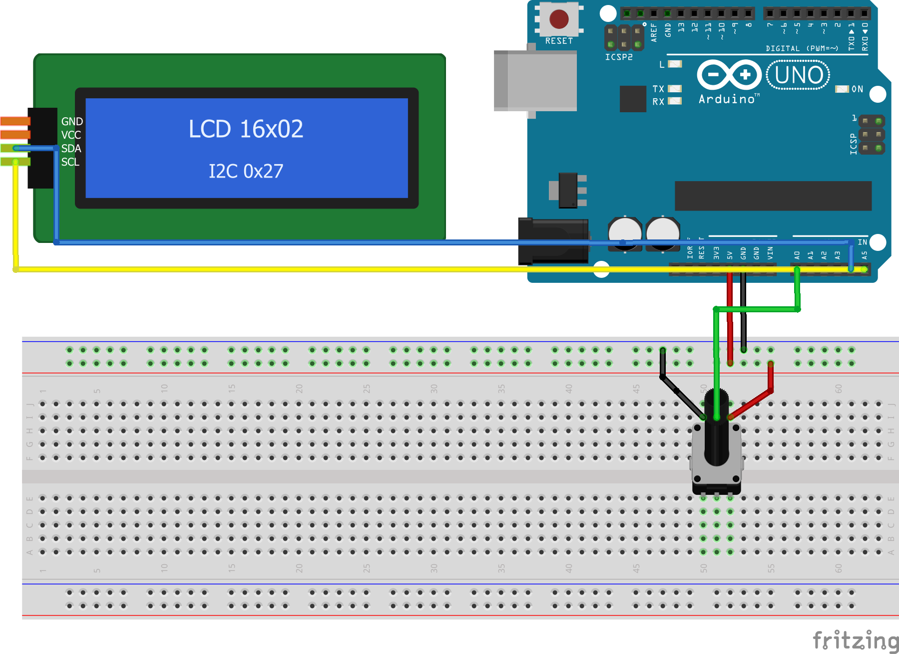

# 미션 : 동작중임을 나타내는 캐릭터 모션 만들기

> 창의설계입문 C08 과제 · 인천대학교 임베디드시스템공학과
> 김주영 (202601527)

LCD 16x02의 **첫째 줄 첫 글자(0,0) 한 칸**에서 하트가 실제 심장처럼 **"쿵-쿵, 쉼"** 으로 뜁니다.
가변저항을 올릴수록 심박수가 **40 → 180 BPM** 으로 빨라지고, 프로그램이 멈추면 심장도 멈춥니다.
임베디드 시스템에서 "살아 있음"을 알리는 신호를 **하트비트(heartbeat)** 라고 부르는데, 그 이름을 그대로 눈에 보이게 만든 것입니다.

### 🎬 실제 동작 영상

가변저항을 돌리면 심박수가 빨라지는 모습입니다.

<video src="docs/demo.mp4" controls muted playsinline width="480"></video>

영상이 재생되지 않으면 [여기를 눌러 직접 보기](docs/demo.mp4)

### 시뮬레이션 (50 · 90 · 160 BPM)



---

## 1. 연결도



| 부품 | 핀 | Arduino UNO | 역할 |
|---|---|---|---|
| I2C LCD | GND | GND (− 레일) | 기준 전압 0 V |
| I2C LCD | VCC | 5V (+ 레일) | 전원 5 V − 0 V |
| I2C LCD | SDA | A4 | I2C 데이터 |
| I2C LCD | SCL | A5 | I2C 클럭 |
| 가변저항 | 양쪽 핀 | 5V / GND (레일) | 0 ~ 5 V 전압 분배 |
| 가변저항 | 가운데 핀 | A0 | 심박수 입력 |

- 라이브러리: **LiquidCrystal I2C** (Frank de Brabander, 이름 끝에 I2C가 붙은 것)
- I2C 주소 `0x27` (화면이 안 나오면 `0x3F`)
- 가변저항을 A4, A5에 연결하면 안 되는 **이유는** 두 핀이 이미 LCD의 I2C 통신선이기 때문이다.

> 프리칭 연결도: [`docs/wiring.fzz`](docs/wiring.fzz)

---

## 2. 하트 디자인

5x8 한 칸에 **기본 하트**와 **큰 하트** 두 장만 그렸습니다. 처음에는 4단계로 만들었지만, 실제 LCD에서는 두 장을 또렷하게 바꾸는 쪽이 박동이 더 잘 보여서 둘만 남겼습니다. 아래쪽 뾰족한 끝을 거의 같은 위치에 두고 위로 부풀어 오르게 만든 **이유는**, 하트가 위치는 그대로인 채 "펌프질"하는 것처럼 보이게 하기 위해서입니다.

```
기본(쉼)   큰(쿵!)
.....     ##.##
.#.#.     #####
#####     #####
#####     #####
.###.     #####
..#..     .###.
.....     ..#..
.....
```

---

## 3. 박동은 어떻게 만들었나
## 아두이노 스케치

```cpp
#include <LiquidCrystal_I2C.h>

LiquidCrystal_I2C lcd(0x27, 16, 2);

byte heart[2][8] = {
  { B00000, B01010, B11111, B11111, B01110, B00100, B00000, B00000 },
  { B11011, B11111, B11111, B11111, B11111, B01110, B00100, B00000 }
};

unsigned long phase, last;
long pot = 512L * 8;
int bpm, shown, beat = -1;

void setup() {
  lcd.init();
  lcd.backlight();
  last = millis();
}

void loop() {
  unsigned long now = millis();
  pot += analogRead(A0) - pot / 8;
  bpm = map(pot / 8, 0, 1023, 40, 180);

  phase = (phase + (now - last) * bpm) % 60000;
  last = now;
  int t = phase / bpm;
  int b = t < 140 || (t > 200 && t < 280);

  if (b != beat) {
    beat = b;
    lcd.createChar(0, heart[b]);
    lcd.setCursor(0, 0);
    lcd.write(byte(0));
  }

  if (bpm != shown) {
    shown = bpm;
    char s[8];
    sprintf(s, "%3d BPM", bpm);
    lcd.setCursor(9, 0);
    lcd.print(s);
  }
}
```

---

### 3-1. 실제 심장 소리 "lub-dub"을 흉내 낸 박동 곡선

실제 심장은 한 번에 두 번 뜁니다. 크게 "쿵"(lub) 하고 바로 작게 "쿵"(dub) 한 뒤 쉽니다.
그래서 한 박동 안의 시간 `tms`에 따라 하트 크기를 아래처럼 **계단식으로** 바꿨습니다.

```
크기
 큰 하트   |█████████      █████               <- 쿵!(길게)  쿵(짧게)
 기본 하트 |         ██████     ██████████████  <- 쉼
           0        140   200  280           다음 박동
                          ms
```

```cpp
int b = t < 140 || (t > 200 && t < 280);   // 1이면 큰 하트, 0이면 기본 하트
```

"쿵-쿵-쉼" 리듬 전체를 조건식 **한 줄**로 표현했다. 이렇게 한 **이유는** 박동 패턴이 "큰 하트인 구간 두 개"로만 이루어져 있어서, 그 구간을 그대로 논리식으로 쓰는 것이 가장 짧고 읽기 쉽기 때문이다. 결과가 0 또는 1이라서 `heart[b]`로 바로 하트 모양을 고를 수 있다.

두 번째 "쿵"을 첫 번째보다 짧게(140 ms → 80 ms) 만든 **이유는**, 크기는 같아도 길이가 다르면 "쿵-쿵"의 강약이 느껴지기 때문이다.

**쉬는 하트를 기본 크기 하트로 정한 이유는**, 처음에는 쉴 때 아주 작은 하트를 썼는데 평소에 보이는 하트가 너무 작아서 점 몇 개처럼 보였기 때문이다. 하트는 쉬는 시간에 가장 오래 보이므로, 평소 모습이 제대로 된 하트여야 한다.

**왜 두 번 뛰게 했냐면**, 한 번만 커졌다 작아지면 그냥 "깜빡이는 점"처럼 보이지만, 쿵-쿵 리듬이 있으면 사람들이 바로 "심장"으로 알아보기 때문이다.

**왜 중간 단계 없이 한 번에 바꿨냐면**, 처음에는 크기를 0→1→2→3으로 한 단계씩 부드럽게 키웠는데 실제 LCD에서는 박동이 애매하게 꿈틀거리는 것처럼만 보였기 때문이다. 단계 사이의 차이가 작은 데다, LCD 액정은 반응 속도가 느려서(수십~수백 ms) 최고점에 잠깐만 머물면 큰 하트가 다 그려지기도 전에 다음 단계로 넘어가 버린다. 그래서 작은 하트에서 큰 하트로 **한 번에** 바꾸고, 큰 하트를 140 ms 동안 유지해 액정이 완전히 반응할 시간을 줬다. 그 결과 박동이 훨씬 또렷하게 보이게 됐다.
또 박동 자체의 길이(약 300 ms)는 BPM과 상관없이 고정하고 **쉬는 시간만** 줄였다. **왜냐하면** 실제 심장도 빨리 뛸 때 수축 시간보다 쉬는 시간이 훨씬 많이 줄어들기 때문이다. 덕분에 180 BPM에서도 박동 모양이 뭉개지지 않는다.

### 3-2. 가변저항을 돌려도 박자가 튀지 않게 — 위상 누적

```cpp
phase = (phase + (now - last) * bpm) % 60000;   // 한 박동 = 60000
int t = phase / bpm;                            // 이번 박동 시작 후 경과 ms
```

가장 쉬운 방법은 `millis() % 주기`인데, 이렇게 하면 가변저항을 돌려 주기가 바뀌는 순간 위치가 갑자기 다른 곳으로 점프한다.
**왜냐하면** 같은 시각이라도 주기가 달라지면 나머지 값이 완전히 달라지기 때문이다.
그래서 "지금까지 얼마나 진행했는지"를 `phase`에 계속 **더해 가는** 방식으로 바꿨다. 1 ms가 지날 때마다 BPM만큼 전진하고, 60000에 도달하면 한 박동이 끝난다. 
`dt × BPM`을 쓴 **이유는** `분당 박동 수 × 경과 ms = 60000`일 때 정확히 한 박동이 되도록 단위를 맞추면, 나눗셈이나 실수(float) 없이 정수만으로 계산할 수 있기 때문이다.

### 3-3. 손 떨림 제거 — 지수 이동 평균

```cpp
pot += analogRead(A0) - pot / 8;          // 새 값 1/8 + 이전 값 7/8
bpm = map(pot / 8, 0, 1023, 40, 180);
```

`analogRead()` 값은 가만히 있어도 ±1~2씩 흔들린다. 그대로 쓰면 BPM 숫자가 계속 깜빡이고 박동도 미세하게 떨린다.
**그래서** 새 값은 1/8만 반영하는 평균을 썼다. 8배 확대해서 저장하는 **이유는** 정수 나눗셈에서 소수점이 버려져 평균이 한쪽으로 치우치는 것을 막기 위해서다.

### 3-4. 바뀔 때만 그린다

```cpp
if (b != beat) {
  beat = b;
  lcd.createChar(0, heart[b]);
  lcd.setCursor(0, 0);
  lcd.write(byte(0));
}
```

상태는 loop()마다 계산하지만, LCD에는 **하트 크기가 바뀔 때만** 쓴다. **왜냐하면** `createChar()` 한 번에 I2C로 9바이트(명령 1 + 모양 8)를 보내야 해서, 매번 쓰면 통신 시간이 낭비되기 때문이다. 쉬는 구간에는 LCD 통신이 아예 일어나지 않는다. BPM 숫자도 같은 원리로 값이 바뀔 때만 다시 쓴다.

---

## 4. 요구 사항을 어떻게 만족했나

| 요구 사항 | 적용한 방법 |
|---|---|
| Custom Character 사용 | 하트 두 장(기본·큰)을 CGRAM 0번 한 칸에 번갈아 등록 (`createChar`) |
| 부드러운 동작 | 일정한 쿵-쿵 리듬, LCD 반응 속도를 고려해 각 크기를 충분히 유지, 위상 누적으로 속도를 바꿔도 박자가 끊기지 않음, 지수 평균으로 떨림 제거 |
| 직관적으로 "동작 중" | 뛰는 심장 = 살아 있음. loop()가 멈추면 박동도 멈추므로 멈춘 하트 = 멈춘 프로그램 |
| 첫째 줄 첫 글자 활용 | 애니메이션은 (0,0) 한 칸에서만 진행. 오른쪽 BPM 숫자는 가변저항 값을 보여 주는 보조 정보 |

---

## 5. 고찰

1. **"모양"보다 "리듬"이 의미를 만든다.**
   5x8 점 40개로는 하트를 정교하게 그릴 수 없었다. 그런데 크기를 쿵-쿵 리듬으로 바꾸자 작은 점 덩어리도 바로 심장으로 보였다. 픽셀이 적을수록 그림보다 **움직임의 패턴**이 정보를 전달한다는 것을 느꼈다.

2. **시간 기반 애니메이션에서 `%` 연산의 함정.**
   가장 쉬운 `millis() % 주기` 방식은 가변저항을 돌릴 때마다 하트가 갑자기 커지거나 작아지는 문제가 생긴다. 주기가 바뀌면 같은 시각의 나머지 값이 달라지기 때문이다. 그래서 위상을 누적하는 방식을 택했고, 이 방식은 신디사이저의 오실레이터(NCO)에서도 쓰이는 방법이라는 것을 알게 됐다.

3. **CGRAM 갱신과 호환 LCD.**
   원래 HD44780은 CGRAM 모양만 바꿔도 화면에 바로 반영되어야 하지만, 실습 중 캐릭터가 갱신되지 않는 것처럼 보이는 문제가 있었다. 그래서 모양을 바꾼 뒤 (0,0)에 문자를 한 번 더 쓰도록 했다. 데이터시트대로만 동작한다고 가정하면 안 되고, 실제 하드웨어에서 확인해야 한다는 것을 배웠다.

4. **`createChar()` 뒤에는 `setCursor()`.**
   `createChar()`는 LCD 내부 주소를 CGRAM으로 옮겨 놓는다. 그래서 바로 `print()`를 하면 BPM 숫자가 화면이 아니라 CGRAM에 써져 하트 모양이 깨질 수 있다. 숫자를 쓰기 전에 항상 `setCursor()`로 화면 주소를 되돌렸다.

5. **아날로그 입력의 노이즈.**
   가변저항을 가만히 두어도 `analogRead()` 값은 조금씩 흔들리기 때문에, 그대로 쓰면 BPM 숫자가 깜빡인다. 지수 이동 평균으로 이를 줄였지만, 평균을 너무 강하게 하면 손잡이를 돌렸을 때 반응이 늦어진다. 반응 속도와 안정성 사이에서 균형을 잡아야 했고, 새 값 1/8 반영을 선택했다.

6. **개선 아이디어.**
   - BPM이 150을 넘으면 하트 옆에 땀방울을 띄워 "과부하" 상태를 표현할 수 있다.
   - 가변저항 대신 실제 센서(온도, 조도)나 CPU 사용량을 BPM에 연결하면 진짜 "상태 표시기"가 된다.
   - 워치독 타이머와 함께 쓰면, 심장이 멈췄을 때(프로그램이 멈췄을 때) 자동으로 리셋되는 시스템을 만들 수 있다.

---

## 6. 파일 구성

```
heartbeat/
├─ README.md               ← 이 페이지
├─ heartbeat/
│  └─ heartbeat.ino        ← 아두이노 스케치
└─ docs/
   ├─ wiring.png / .svg    ← 연결도
   ├─ wiring.fzz           ← 프리칭 파일
   ├─ preview.gif          ← BPM별 시뮬레이션
   └─ demo.mp4             ← 실제 동작 영상
```
